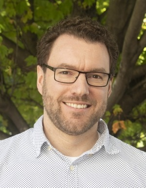
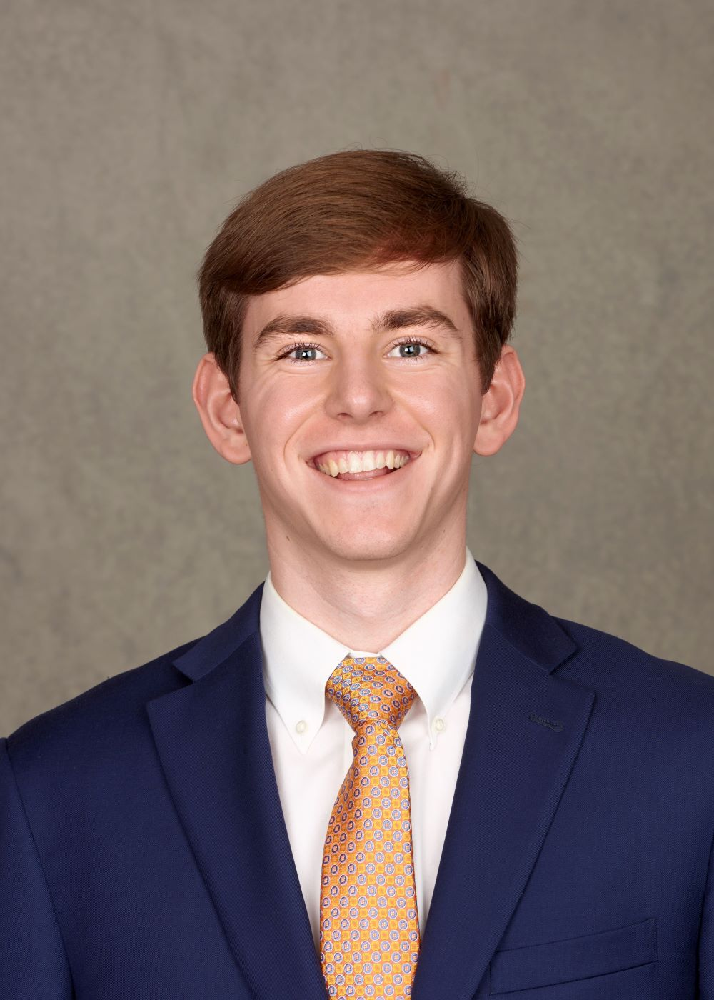
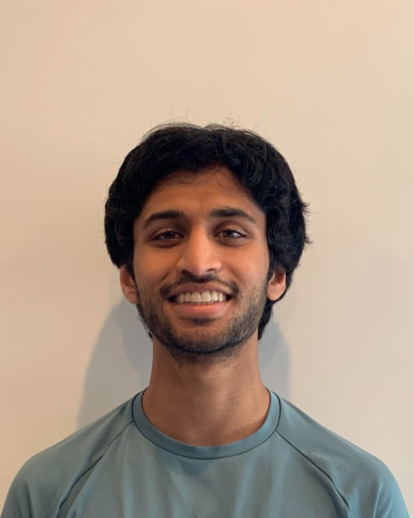

======
People
======

Principal Investigator
======================

Dr. Graeme J. Kennedy
---------------------

Dr. Graeme J. Kennedy is an associate professor in the Guggenheim School of
Aerospace Engineering at the Georgia Institute of Technology where he
leads his research team. His research involves the development and application
of numerical optimization techniques to structural and multidisciplinary design
problems, with a primary focus on the analysis and design of fixed-wing
aircraft. Before joining the faculty, Dr. Kennedy was a postdoctoral research
fellow at the University of Michigan in the Department of Aerospace
Engineering. Dr. Kennedy received his PhD from the University of
Toronto Institute for Aerospace Studies (UTIAS) in 2012.

- External links:
    - `Google Scholar <https://scholar.google.com/citations?user=LHqGhxkAAAAJ&hl>`_

Current Students
================

Brian J. Burke, 2021 - present
---------------------------------

.. image:: images/people/Brian.jpg
   :width: 120 px
   :align: right

Brian J. Burke is a Ph.D. candidate in Aerospace Engineering at the Georgia Institute of Technology. He is a member of the
development team for FUNtoFEM, the group's interface for coupled aerothermoelastic analysis, design, and optimization. Brian is also leading
a new project to perform aerostructural analyses and optimizations of truss-braced wings using several levels of fidelity.
Before coming to Georgia Tech, Brian earned his Bachelors of Science with Honors in Aeronautical and Aeronautical Engineering
from Purdue University in 2021. While at Purdue, he conducted research in Prof. Jonathan Poggie's hypersonics group, with a focus on scramjet unstart.

- External links:
    - `GitHub <https://github.com/bburke38/>`_
    - `Linkedin <https://www.linkedin.com/in/brian-burke-aero/>`_

Cameron Smith, 2022 - present
---------------------------------

Cameron Smith is a Ph.D. student in Aerospace Engineering at the Georgia Institute of Technology.
Currently, he is working on developing an electric motor model to be used for trajectory and topology optimization,
specifically for applications in electric vertical take-off and landing vehicles. Prior to joining Georgia Tech,
Cameron received his B.S. in Aerospace Engineering at Rensselaer Polytechnic Institute (RPI). During his time at RPI,
Cameron's research focus was in multi-fidelity structural modeing for unmanned aerial vehicles.

- External links:
   - `GitHub <https://github.com/csmith763>`_
   - `Linkedin <https://www.linkedin.com/in/cameron-smith01/>`_

Seiyon Arulampalam, 2023 - present
---------------------------------

Seiyon Arulampalam is a Ph.D. student in Aerospace Engineering at the Georgia Institute of Technology. He holds an Aeronautical Engineering degree from Rensselaer Polytechnic Institute and is interested in multidisciplinary optimization problems for novel aircraft configurations.  His current research project involves developing a high-fidelity coupled electromagnetic-thermal finite element toolkit for shape optimization of electric motors.

- External links:
   - `Linkedin <https://www.linkedin.com/in/seiyon-arulampalam-a42282358/>`_

Previous Students
=================

Ph.D. Alumni
------------
- Sean P. Engelstad, Ph.D., 2021-2026, thesis: *Data-Driven and GPU-Accelerated Computational Methods for High-Fidelity Aerostructural Design*
- Yicong Fu, Ph.D., 2020-2025, thesis: *Structural Topology Analysis and Optimization Methods for Large-Scale Problems and High-Order Discretizations*
- Bao Li, Ph.D., 2020-2024, thesis: *Topology optimization with natural frequency and structural stability criteria using eigenvector aggregates*
- James Gloyd, Ph.D., 2019 - 2023, thesis: *Mechanical Metamaterial Lattices via Direct Methods*
- Mark Leader, Ph.D., 2016 - 2021, thesis: *Stress-Based Topology Optimization for Steady-State and Transient Thermoelastic Design*
- Komahan Boopathy, Ph.D., 2015 - 2020, thesis: *Adjoint Based Design Optimization of Systems with Time Dependent Physics and Probabilistically Modeled Uncertainties*
- Adam T. Sidor *(Co-supervised with Prof. Robert Braun)*, Ph.D., 2019, thesis: *Design and Manufacturing of Conformal Ablative Heatshields*
- Kevin Jacobson *(Co-supervised with Prof. Marilyn Smith)*, Ph.D., 2019, thesis: *Adjoint-Based Aeroelastic Optimization with High-Fidelity Time-Accurate Analysis*
- Ting Wei Chin, Ph.D., 2019, thesis: *Multi-Physics High Resolution Topology Optimization for Aerospace Structures*

M.S. Alumni
-----------
- Lonnie Webb, 2023
- Rohan Patel, 2022
- Sejal Sahu, 2022
- Lenard Halim, 2021
- Liam Smith, 2020
- Zongxu Dong, 2020
- Jan F. Kiviaho, 2018
- Adrien Hervet, 2017
- Chunrong Ngoh, 2017
- Maegan Lee, 2016
- Sui An, 2015
